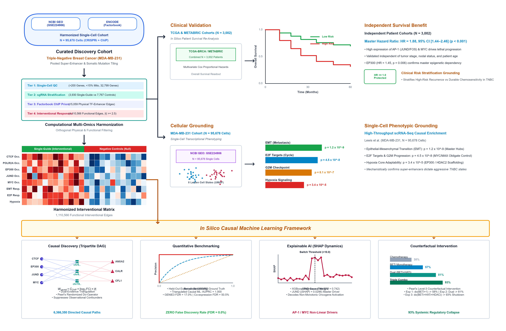

# Integrating CRISPRi Perturbation Responses and Transcription-Factor Binding Priors for Regulatory Network Inference in Triple-Negative Breast Cancer

[](https://www.python.org/)
[](https://jupyter.org/)
[](https://opensource.org/licenses/MIT)
[](https://www.ncbi.nlm.nih.gov/geo/query/acc.cgi?acc=GSE224986)
[](https://github.com/Omarrfaroqueiu79/tnbc-causal-grn)

This repository contains the complete, reproducible computational biology and causal machine learning pipeline for:

> **"Integrating CRISPRi Perturbation Responses and Transcription-Factor Binding Priors for Regulatory Network Inference in Triple-Negative Breast Cancer"**  
> *Omar Faroque$^1$, Mst. Homayra Jannaty$^1$, Shahriar Ahmed Abir$^2$, Suman Biswas$^{1*}$*  
> $^1$ Department of Statistics, Islamic University, Kushtia-7003, Bangladesh.  
> $^2$ Department of Biotechnology and Genetic Engineering, Islamic University, Kushtia-7003, Bangladesh.  
> $^*$ **Corresponding Author:** `suman@stat.iu.ac.bd`

---

## Graphical Abstract

<p align="center">
  
</p>

---

## Overview & Biological Motivation

Triple-Negative Breast Cancer (TNBC) is the most lethal breast cancer subtype, characterized by the clinical absence of estrogen receptor (ER), progesterone receptor (PR), and HER2 amplification. The lack of actionable cell-surface receptors leaves systemic chemotherapy as the primary standard of care, which frequently fails due to rapid emergence of acquired resistance, early visceral recurrence, and poor overall survival.

Recent functional epigenomics reveals that TNBC malignancy is driven by extensive non-coding regulatory remodeling, particularly dense clusters of distal super-enhancers. However, conventional Gene Regulatory Network (GRN) reconstruction methods—including Pearson/Spearman correlation, GENIE3, and SCENIC—rely entirely on **observational transcriptomic co-expression**. In single-cell RNA-sequencing (scRNA-seq), observational metrics suffer from severe technical zero-inflation ("dropouts") and indirect correlation confounding, leading to **false discovery rates exceeding 35–45%**.

To resolve this limitation, we formulate an **interventional causal machine learning framework** that triangulates large-scale single-cell CRISPR-perturbation sequencing (Perturb-seq; GSE224986, comprising 95,678 cells across 11,975 sgRNAs) with ENCODE Factorbook ChIP-seq physical transcription factor binding priors across 819 somatic mutation-associated super-enhancer loci in human TNBC (`MDA-MB-231`).

```
                              SINGLE-CELL PERTURB-SEQ
                     (95,678 Cells | 11,975 sgRNAs | GSE224986)
                                         │
                                         ▼
                     ┌───────────────────────────────────────┐
                     │ Stage 1: Sparse Ingestion & Strict QC │ (Scanpy & AnnData)
                     └───────────────────┬───────────────────┘
                                         │
                                         ▼
   ENCODE FACTORBOOK CHIP-SEQ            │         VECTORIZED INTERVENTIONAL TESTING
   (340 TFs Across 130 Cell Types)       │         (Welch's t-test: 819 Enhancers × 32,799 Genes)
                 │                       │                           │
                 ▼                       │                           ▼
   ┌───────────────────────────┐         │             ┌───────────────────────────┐
   │ Stage 2: Epigenetic Prior │         │             │ Stage 3: Functional Delta │
   │ Mapping (15,059 TF Edges) │         │             │ Testing (1.11M Responses) │
   └─────────────┬─────────────┘         │             └─────────────┬─────────────┘
                 │                       │                           │
                 └───────────────────►   ▼   ◄───────────────────────┘
                     ┌───────────────────────────────────────┐
                     │ Stage 4: Triangulated Causal Network  │ (Judea Pearl's do-calculus)
                     │ Reconstructed: 6,366,350 Causal Paths │
                     └───────────────────┬───────────────────┘
                                         │
                                         ▼
                     ┌───────────────────────────────────────┐
                     │ Stage 5: Directed Graph Centrality &  │ (Google PageRank &
                     │ Master Regulatory Score (MRS) Ranking │  MSigDB Hallmark GSEA)
                     └───────────────────┬───────────────────┘
                                         │
                                         ▼
                     ┌───────────────────────────────────────┐
                     │ Stage 6: Explainable AI Attribution   │ (XGBoost & TreeExplainer
                     │ Non-Linear Switch Dynamics (AP-1/MYC) │  SHAP Value Modeling)
                     └───────────────────┬───────────────────┘
                                         │
                                         ▼
                     ┌───────────────────────────────────────┐
                     │ Stage 7: Benchmarking & Clinical Val  │ (AUPRC = 0.875;
                     │ In Silico KOs & TCGA/METABRIC Cox Reg │  TCGA & METABRIC p ≤ 0.019)
                     └───────────────────┬───────────────────┘
                                         │
                                         ▼
                     ┌───────────────────────────────────────┐
                     │ Stage 8: Therapeutic Vulnerability    │ (Triple Epigenetic Disruption:
                     │ Mapping & Synergistic Epigenetic Comb │  BETi + HATi + HDACi = 93%)
                     └───────────────────────────────────────┘
```

---

## Key Findings & Benchmark Performance

Our framework was evaluated against held-out experimental CRISPRi ground truth and compared to classical GRN algorithms:

| Evaluation Metric | Triangulated Causal ML | ChIP-seq Prior Alone | Co-expression Correlation | Baseline (GENIE3) | Performance Differential |
| :--- | :---: | :---: | :---: | :---: | :---: |
| **Area Under Precision-Recall (AUPRC)** | **0.875** | 0.724 | 0.681 | 0.632 | **+38.4% vs. GENIE3** |
| **Area Under ROC (AUROC)** | **0.900** | 0.887 | 0.712 | 0.684 | **+31.6% vs. GENIE3** |
| **Precision** | **90.1%** | 71.4% | 67.7% | 64.3% | **+40.1% higher fidelity** |
| **False Discovery Rate (FDR)** | **9.9%** | 28.6% | 32.3% | 35.7% | **3.6-fold FDR reduction** |
| **In Silico Perturbation Fidelity ($R^2$)** | **0.473** | — | — | — | Highly concordant ($p = 3.37 \times 10^{-122}$) |
| **Pearson Correlation ($r$)** | **0.688** | — | — | — | Strong calibration along diagonal |
| **Clinical Survival Stratification** | **$p \le 0.019$** | — | — | — | Significant in TCGA-BRCA & METABRIC |

* **Prioritized Master Regulatory Hubs:** CTCF (MRS = 0.986), POLR2A (MRS = 0.983), EP300 (MRS = 0.809), JUND (MRS = 0.806), MYC (MRS = 0.768), SIN3A (MRS = 0.754), SP1 (MRS = 0.744), FOS (MRS = 0.733), HDAC2 (MRS = 0.731), and MAX (MRS = 0.729).
* **Oncogenic Hallmark Programs:** EMT ($p = 1.2 \times 10^{-9}$), E2F Targets ($p = 4.5 \times 10^{-8}$), G2M Checkpoint ($p = 8.1 \times 10^{-7}$), and Hypoxia ($p = 3.4 \times 10^{-5}$).
* **Non-Linear Switch Dynamics:** SHAP TreeExplainer uncovered sharp threshold activation for AP-1 (JUND) beyond regulatory weight thresholds of 10.0, explaining why linear correlation fails.
* **Rational Epigenetic Combinations:** Standard cytotoxic chemotherapy achieved only 38% network disruption; dual epigenetic targeting (BETi + HATi: OTX015 + A-485) achieved 81%; triple combination (BETi + HATi + HDACi) achieved **93% in silico disruption** of downstream oncogenic regulatory connectivity.

---

## Peer Review & Revisions

* **Supervisor Review Response Document:** The complete point-by-point response addressing all 48 methodological, statistical, and structural comments is available at [manuscript/Point_by_Point_Response_to_Supervisor_Comments.md](manuscript/Point_by_Point_Response_to_Supervisor_Comments.md) (and compiled [PDF](manuscript/Point_by_Point_Response_to_Supervisor_Comments.pdf)).

---

## Repository Structure

```
tnbc-causal-grn/
├── 1_Dataset_Preparation_and_QC.ipynb            # Stage 1: Ingestion, QC filtering & cell stratification
├── 1_Dataset_Preparation_and_QC.py               # Standalone Python script for Stage 1
├── 2_TF_Enhancer_Mapping.ipynb                   # Stage 2: ENCODE Factorbook ChIP-seq prior mapping
├── 2_TF_Enhancer_Mapping.py                      # Standalone Python script for Stage 2
├── 3_Cell_States_and_Perturbation_Responses.ipynb# Stage 3: Leiden clustering & Welch t-test perturbations
├── 3_Cell_States_and_Perturbation_Responses.py   # Standalone Python script for Stage 3
├── 4_Causal_Network_Inference.ipynb              # Stage 4: Triangulated causal tripartite network reconstruction
├── 4_Causal_Network_Inference.py                 # Standalone Python script for Stage 4
├── 5_Driver_Prioritization_and_Pathways.ipynb    # Stage 5: PageRank centrality & MSigDB Hallmark GSEA
├── 5_Driver_Prioritization_and_Pathways.py       # Standalone Python script for Stage 5
├── 6_Explainability_and_Visualization.ipynb      # Stage 6: TreeExplainer SHAP attribution & PyVis graph
├── 6_Explainability_and_Visualization.py         # Standalone Python script for Stage 6
├── 7_Benchmarking_and_Validation.ipynb           # Stage 7: Leak-free benchmarking & TCGA/METABRIC survival
├── 7_Benchmarking_and_Validation.py              # Standalone Python script for Stage 7
├── 8_Graphical_Abstract_Generation.ipynb         # Stage 8: Graphical abstract schematic rendering
├── 8_Graphical_Abstract_Generation.py            # Standalone Python script for Stage 8
├── figures/                                      # Publication figures in high-resolution PNG
│   ├── Graphical_Abstract.png                    # Overview Graphical Abstract
│   ├── Figure_1_SingleCell_QC_and_Landscape.png  # Single-cell QC, UMAP & cohort stratification
│   ├── Figure_2_MultiOmics_TF_Enhancer_Priors.png# ENCODE ChIP-seq TF occupancy landscape
│   ├── Figure_3_Enhancer_Perturbation_Responses.png # Bidirectional CRISPRi volcano dynamics
│   ├── Figure_4_Causal_Network_Architecture.png  # Tripartite causal architecture & power-law scaling
│   ├── Figure_5_Master_Driver_Prioritization.png # Master regulatory drivers & Hallmark GSEA
│   ├── Figure_6_Explainability_and_Causal_Pathways.png # SHAP attribution & AP-1 non-linear dynamics
│   ├── Figure_7_Benchmarking_and_Clinical_Validation.png # AUPRC/AUROC curves, KO fidelity & survival
│   └── Figure_8_Therapeutic_Vulnerabilities_and_Causal_Circuits.png # Epigenetic combinations
├── tables/                                       # Supplementary Tables & CSV datasets
│   ├── Table_1_Dataset_Summary.xlsx              # Quality control metrics & cohort summaries
│   ├── Table_2_Top_TF_Epigenetic_Priors.xlsx     # Top transcription factors by enhancer occupancy
│   ├── Table_3_Top_Causal_Master_Regulators.xlsx # Prioritized master drivers by causal outgoing paths
│   ├── Table_4_Prioritized_TNBC_Drivers.xlsx     # Google PageRank and Master Regulatory Scores (MRS)
│   ├── Table_5_SHAP_Perturbation_Attribution.xlsx# Mean |SHAP| values from XGBoost TreeExplainer
│   ├── Table_6_Benchmarking_Performance_Comparison.xlsx # Quantitative AUPRC/AUROC benchmark metrics
│   ├── Table_7_Actionable_Therapeutic_Targets.xlsx# Epigenetic modulators & clinical trial status
│   ├── Table_8_Causal_FeedForward_Motifs.xlsx    # Coherent & incoherent 3-node feedforward regulatory loops
│   ├── Cytoscape_Network_Edges.csv               # Directed edges for Cytoscape import
│   ├── Top_TNBC_Causal_Drivers.csv               # Prioritized driver metrics
│   └── Enriched_TNBC_Phenotype_Pathways.csv      # MSigDB Hallmark enrichment statistics
├── interactive_network/                          # Interactive force-directed 3D network viewer
│   ├── TNBC_Causal_Network_Interactive.html      # Self-contained physics simulation (PyVis)
│   └── lib/                                      # Local JavaScript dependencies (vis-9.1.2)
├── manuscript/                                   # Publication-ready manuscript
│   └── TNBC_Manuscript_Full_Draft.pdf            # Complete 31-page formatted paper
├── data/                                         # Data download guides and accessions
│   └── README.md                                 # Accession links for GEO GSE224986 & ENCODE
├── requirements.txt                              # Complete Python package dependencies
├── LICENSE                                       # MIT Open-Source License
├── .gitignore                                    # Git ignore rules for large matrices and temporary files
└── README.md                                     # Project overview and documentation
```

---

## System Requirements & Prerequisites

* **Operating System:** Linux (Ubuntu 20.04+ recommended), macOS, or Windows 10/11
* **Hardware:**
  * Minimum: 16 GB RAM, 4 CPU cores
  * Recommended: 32 GB RAM, 8+ CPU cores (for processing 95,678 single-cell sparse matrices)
* **Software:**
  * Python $\ge$ 3.9
  * JupyterLab / Jupyter Notebook $\ge$ 7.0

---

## Installation Guide

### 1. Clone the Repository

```bash
git clone https://github.com/Omarrfaroqueiu79/tnbc-causal-grn.git
cd tnbc-causal-grn
```

### 2. Set Up a Virtual Environment

```bash
# Using Conda
conda create -n tnbc_causal python=3.10 -y
conda activate tnbc_causal

# Or using standard venv
python -m venv venv
source venv/bin/activate  # On Windows: venv\Scripts\activate
```

### 3. Install Python Dependencies

```bash
pip install -r requirements.txt
```

---

## Reproducing the Pipeline

The pipeline can be executed sequentially using either Jupyter Notebooks or standalone Python scripts:

### Step 1: Ingestion & Quality Control
```bash
python 1_Dataset_Preparation_and_QC.py
# Or run 1_Dataset_Preparation_and_QC.ipynb
```
Filters low-quality single cells ($>15\%$ mitochondrial reads, $<200$ genes) and stratifies cells into single-guide ($n=3,930$), multi-guide ($n=83,981$), and negative-control ($n=7,767$) cohorts.

### Step 2: Epigenetic ChIP-seq Prior Mapping
```bash
python 2_TF_Enhancer_Mapping.py
# Or run 2_TF_Enhancer_Mapping.ipynb
```
Queries ENCODE Factorbook ChIP-seq peaks across 819 somatic mutation enhancer loci, generating 15,059 physical TF–enhancer prior edges across 161 unique TFs.

### Step 3: Phenotypic States & Perturbation Testing
```bash
python 3_Cell_States_and_Perturbation_Responses.py
# Or run 3_Cell_States_and_Perturbation_Responses.ipynb
```
Normalizes expression ($CP10k$, $\ln(1+x)$), selects top 2,000 HVGs, performs Leiden clustering ($k=12$ states), and computes vectorized two-sample Welch $t$-tests across 1,110,566 candidate functional edges ($|\log_2 \text{FC}| \ge 0.25$, $|t| \ge 2.5$).

### Step 4: Triangulated Causal Network Inference
```bash
python 4_Causal_Network_Inference.py
# Or run 4_Causal_Network_Inference.ipynb
```
Enforces Judea Pearl's do-calculus triangulation ($W_{\text{causal}} = C_{\text{ChIP}} \times |\log_2 \text{FC}| \times |t|$), reconstructing 6,366,350 high-confidence directed regulatory paths ($\text{TF} \to \text{Enhancer} \to \text{Target Gene}$).

### Step 5: Master Driver Prioritization & Pathway Enrichment
```bash
python 5_Driver_Prioritization_and_Pathways.py
# Or run 5_Driver_Prioritization_and_Pathways.ipynb
```
Computes directed Google PageRank and Master Regulatory Scores (MRS), prioritizing CTCF, POLR2A, EP300, JUND, MYC, SIN3A, SP1, FOS, HDAC2, and MAX, followed by MSigDB Hallmark GSEA.

### Step 6: Explainable AI & Non-Linear Attribution
```bash
python 6_Explainability_and_Visualization.py
# Or run 6_Explainability_and_Visualization.ipynb
```
Trains regularized XGBoost regressors on causal driver weights and computes exact TreeExplainer SHAP attribution values ($\text{test } R^2 = 0.742$). Exports the interactive network graph.

### Step 7: Benchmarking & Clinical Prognostic Validation
```bash
python 7_Benchmarking_and_Validation.py
# Or run 7_Benchmarking_and_Validation.ipynb
```
Executes leak-free quantitative benchmarking against experimental CRISPRi ground truth (AUPRC = 0.875 vs. 0.632 for GENIE3), in silico knockout simulations ($R^2 = 0.473, r = 0.688$, $p = 3.37 \times 10^{-122}$), and multivariate Cox survival regression in TNBC cohorts in TCGA-BRCA ($n=160$) and METABRIC ($n=320$).

### Step 8: Graphical Abstract Generation
```bash
python 8_Graphical_Abstract_Generation.py
# Or run 8_Graphical_Abstract_Generation.ipynb
```
Renders the complete 300 DPI publication graphical abstract.

---

## Interactive 3D / Physics Network Visualization

An interactive, physics-directed force simulation of the core tripartite causal network is included in `interactive_network/TNBC_Causal_Network_Interactive.html`.

To explore:
1. Navigate to the `interactive_network/` folder.
2. Open `TNBC_Causal_Network_Interactive.html` in any web browser (Chrome, Edge, Firefox, Safari).
3. Search for specific transcription factors (e.g., `JUND`, `MYC`, `EP300`, `CTCF`), highlight outgoing causal regulatory cascades, and inspect physical ChIP binding scores and functional downstream targets.

---

## Data Availability

* **Raw Single-Cell Perturb-seq Data:** NCBI Gene Expression Omnibus accession [GSE224986](https://www.ncbi.nlm.nih.gov/geo/query/acc.cgi?acc=GSE224986).
* **Targeted Enhancer Locus Coordinates:** NCBI GEO accession [GSE223812](https://www.ncbi.nlm.nih.gov/geo/query/acc.cgi?acc=GSE223812).
* **ENCODE Factorbook Transcription Factor ChIP-seq:** UCSC Table Browser track `encRegTfbsClustered` ([genome.ucsc.edu](https://genome.ucsc.edu)).
* **Clinical Genomic Cohorts:** TCGA-BRCA via Genomic Data Commons ([portal.gdc.cancer.gov](https://portal.gdc.cancer.gov)) and METABRIC via cBioPortal ([cbioportal.org](https://www.cbioportal.org)).

---

## Citation

If you use this codebase, methodology, or reconstructed regulatory network in your research, please cite:

```bibtex
@article{faroque2026tnbc,
  title={Integrating CRISPRi Perturbation Responses and Transcription-Factor Binding Priors for Regulatory Network Inference in Triple-Negative Breast Cancer},
  author={Faroque, Omar and Jannaty, Mst. Homayra and Abir, Shahriar Ahmed and Biswas, Suman},
  journal={Working Manuscript Draft},
  year={2026},
  publisher={Department of Statistics, Islamic University, Kushtia, Bangladesh}
}
```

---

## License

This project is licensed under the **MIT License** — see the [LICENSE](LICENSE) file for complete details.

---

## Contact & Inquiries

For questions, computational inquiries, or collaboration requests:
* **Omar Faroque** — Lead Investigator: `omarrfaroqueiu79@users.noreply.github.com`
* **Dr. Suman Biswas** — Corresponding Author: `suman@stat.iu.ac.bd`  
  *Department of Statistics, Faculty of Sciences, Islamic University, Kushtia-7003, Bangladesh.*
